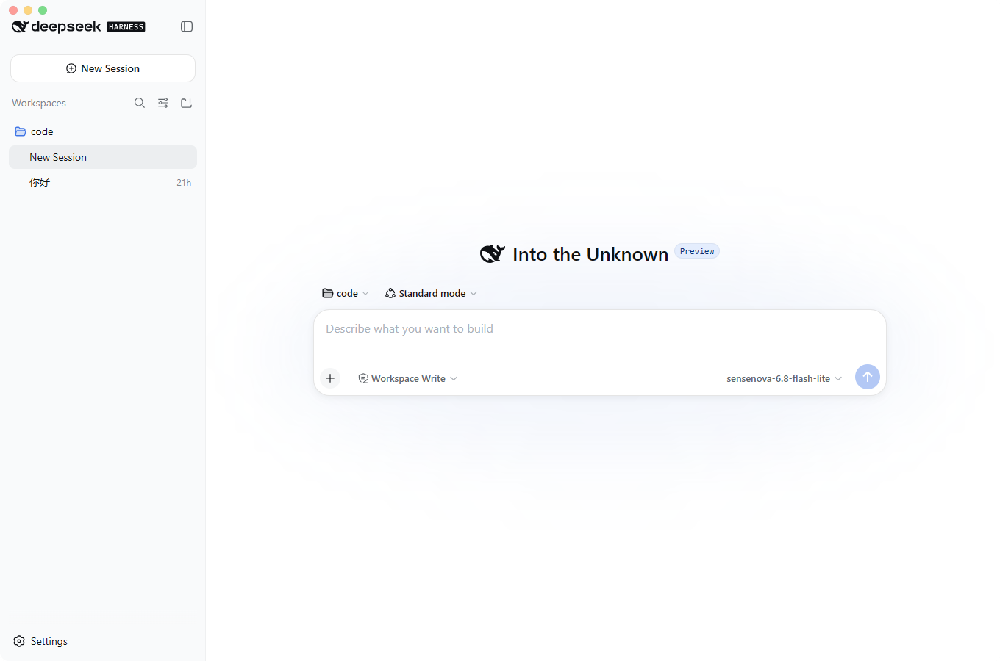

<div align="center">

# dsh desktop

A lightweight desktop client for DeepSeek Harness (`dsh web`), with phone access built in

**[Official Website · Download](https://dsh-desktop.cc.cd/en/)** · **English** · [简体中文](README.md)

<br/>

[](https://dsh-desktop.cc.cd/en/)
[](https://github.com/MochiNek0/dsh-desktop/releases)
[](https://tauri.app/)

[](LICENSE)

<br/>
<br/>



</div>

<br/>

> **Unofficial project**: A third-party desktop client for [DeepSeek Harness](https://github.com/deepseek-ai/deepseek-harness), not affiliated with DeepSeek. [Issues](https://github.com/MochiNek0/dsh-desktop/issues) and PRs welcome.
>
> **Also try the official client**: DeepSeek now provides an official desktop app. Feel free to check it out at the [official DeepSeek Harness website](https://www.deepseek.com/harness/). The difference: this one installs in a few MB, and lets a phone in to the dsh on your computer.

Starts the local `dsh web` in the background on launch and embeds it in a native window — no terminal, no port juggling. Sessions, credentials and config live in `$DSH_HOME` (default `~/.dsh`), the same ones your command-line `dsh` uses.

## Features

- **Connect a phone**: open **Connect a phone…** from the menu, scan the code with the phone's camera and click **Allow** on the computer — the phone's browser now has the dsh running on your computer, sessions and all, with no app to install. Pick one of three channels: **Local network** (same Wi-Fi, through nobody else's servers), **Tailscale** (anywhere, mobile data included) or **Cloudflare** (your own hostname, and the only one of the three with HTTPS; it switches itself off after 30 idle minutes and stays flagged in the tray while up). A pairing code lasts five minutes and works once, and every new device needs a yes from someone at the computer. A pairing holds for thirty days; drop one device, or all of them along with the key. Not a line of dsh is changed.
- **Quick ask & global shortcuts**: Press a global shortcut (default `Ctrl+Alt+Space`, macOS `Ctrl+Option+Q`) to bring up a minimalist prompt box without opening the main window — pick a workspace, an existing session, or a model to send prompts in the background. Toggle the main window with `Ctrl+Alt+D` (`Ctrl+Option+D` on macOS), or send clipboard text straight into the active session draft. All shortcuts are customizable in the settings card.
- **Status awareness & recent workspaces**: Tray and taskbar icons show runtime status at a glance (blue dot while running, orange badge when waiting for you); the tray menu lists active and waiting sessions for one-click jump; recent workspaces stay pinned in both the tray menu and the Windows taskbar jump list.
- **Open any folder directly**: Pass a folder via `dsh-desktop <path>`, right-click a folder in the file manager ("Open in dsh" on Windows, macOS and Linux), or trigger via `dsh-desktop://open?path=` URL scheme to jump straight into that workspace.
- **Light & cross-platform**: Tauri v2 on the system WebView, with no bundled browser engine. Installers are 2.5 MB on Windows, 6.3 MB on macOS, 4.1 MB on Debian, with a unified experience across Windows, macOS, and Linux.
- **Works out of the box**: detects Node, installs `dsh` where needed, and picks a free loopback port so it never collides with an instance you started by hand. No administrator rights at any point.
- **Everything is a plugin**: Not a single line of dsh source code is modified. Desktop enhancements (like system notifications and status signals) are provided as bundled plugins — remove them and dsh returns to a completely pristine state. Features a built-in visual plugin panel highlighting the [DSH Market](https://dshmarket.com) marketplace, with support for installing local plugins via the system file picker.
- **Safe Mode (recover from broken plugins)**: Plugins load before `dsh web` binds its port, so a crashing plugin leaves the app stuck on the loading page — with the removal panel trapped behind the window that won't open. The loading page provides **Start without plugins**: all user plugins are temporarily unmounted from the layer stack (dsh's built-in layers remain untouched) for a clean launch, opening the panel directly so you can uninstall the culprit, then restore the rest via **Load plugins again** in the menu.
- **Native integration**: theme and interface language follow dsh's own settings and switch without a restart; tray-resident with optional start at login; remembers window placement on relaunch without visual glitching; keeps the machine awake while a task is running (toggleable in settings); a system notification when a turn ends or dsh needs you, which returns to that session on click and takes allow/refuse style answers on the notification itself.

## Installation

Download the package for your system from the **[website](https://dsh-desktop.cc.cd/en/)** or [Releases](https://github.com/MochiNek0/dsh-desktop/releases), install, and open it. If no usable Node is found, the Runtime panel opens by itself and installs Node 24 in one click.

| OS | Format | Size | Details |
| :--- | :--- | :--- | :--- |
| **Windows** | `.exe` (NSIS) | 2.5 MB | Needs WebView2; downloaded automatically if missing (verified) |
| **macOS** | `.dmg` | 6.3 MB | Universal binary for Apple Silicon and Intel (verified) |
| **Linux** | `.deb` / `.AppImage` | 4.1 MB / 79 MB | `.AppImage` carries its own WebKit, hence the size, but has the most complete self-updater support (verified on Debian) |

## Notes

- **Node version**: `dsh` needs Node.js 22.19.0 or newer. Neither Node nor `dsh` is bundled, so the first launch needs a connection if they are missing.
- **Closing parks in the tray**: closing the window keeps an in-flight task alive. Use **Quit dsh** in the menu to exit for real.
- **Auto update**: checked silently on launch, raised only when there is one, downloaded only with your consent.
- **Blocked by Gatekeeper on macOS**: right-click the app in Finder and choose "Open", or run `xattr -dr com.apple.quarantine /Applications/dsh-desktop.app`.
- **Installing `github:` plugins**: pnpm blocks build scripts from git sources by default. If it fails, allow the package under `allowBuilds` in `$DSH_HOME/profiles/web/pnpm-workspace.yaml` as the panel describes.

## Configuration

| Variable | Description | Default |
| :--- | :--- | :--- |
| `DSH_BIN` | Absolute path to the `dsh` executable; highest priority, and skips the Node version check | Auto-detected from `PATH` |
| `DSH_HOME` | Directory for `dsh` data, credentials and config | `~/.dsh` |

## Development

Requires Rust stable 1.82+ and Node.js 22+. Linux additionally needs `libwebkit2gtk-4.1-dev`, `libayatana-appindicator3-dev`, `librsvg2-dev`, `patchelf`, `libxdo-dev`, `libssl-dev` and `build-essential`.

```sh
npm install     # install dependencies
npm run dev     # development mode
npm run build   # production bundle, written to src-tauri/target/release/bundle/
```

## Links

- **This Project**: [English](https://dsh-desktop.cc.cd/en/) · [中文](https://dsh-desktop.cc.cd/)
- **Official Desktop App**: [DeepSeek Harness Official Download](https://www.deepseek.com/harness/)
- **Upstream**: [DeepSeek Harness](https://github.com/deepseek-ai/deepseek-harness)
- **Friends**: [DSH Market](https://github.com/dsh-market/dsh-market) — the visual plugin market inside dsh; browse, search and install community plugins in one click ([dshmarket.com](https://dshmarket.com))

## License

[GNU AGPL-3.0](LICENSE). Copyright © 2026 MochiNek0.

This project was MIT; every release after this change is AGPL-3.0. With the
mobile connection in it this app puts a machine that holds a full terminal
session onto a network, and a relay is coming after that. The AGPL is here so
that anything built on it — including anything offered to other people as a
network service — has to hand its source back. **v0.1.19 and every release
before it remain MIT**, and that grant cannot be withdrawn.

`plugin/` — the dsh plugin `dsh-desktop-signal` — stays [MIT](plugin/LICENSE).
It installs into your own dsh profile and sits in a `node_modules` beside
packages that have nothing to do with this project, which is no place to put a
copyleft.
