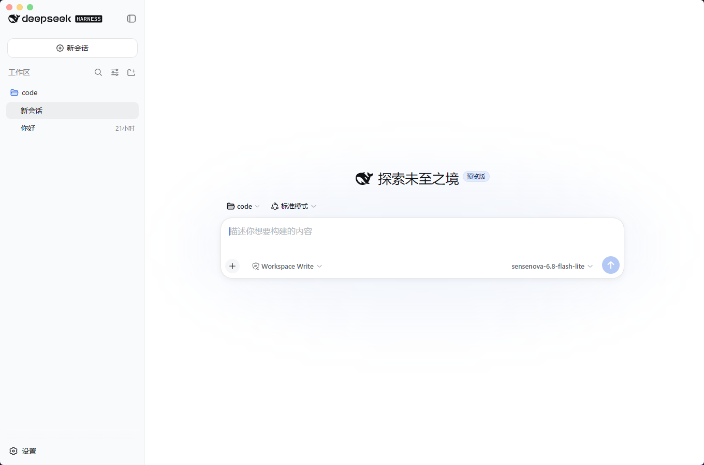

<div align="center">

# dsh desktop

DeepSeek Harness (`dsh web`) 的轻量桌面客户端，支持用手机远程连接

**[官方网站 · 下载](https://dsh-desktop.cc.cd/)** · [English](README.en.md) · **简体中文**

<br/>

[](https://dsh-desktop.cc.cd/)
[](https://github.com/MochiNek0/dsh-desktop/releases)

[](https://tauri.app/)

[](LICENSE)

<br/>
<br/>



</div>

<br/>

> **非官方项目**：基于 [DeepSeek Harness](https://github.com/deepseek-ai/deepseek-harness) 的第三方桌面客户端，与 DeepSeek 官方无隶属关系。欢迎 [Issue](https://github.com/MochiNek0/dsh-desktop/issues) 与 PR。
>
> **也可体验官方客户端**：DeepSeek 现已推出官方桌面端，欢迎前往 [DeepSeek Harness 官网](https://www.deepseek.com/harness/) 下载体验。两者的区别：本项目安装包只有几 MB，并且可以让手机连上电脑里的 dsh。

启动时自动在后台拉起本地 `dsh web` 并嵌入原生窗口，无需开终端、无需管理端口。会话、凭证与配置存放在 `$DSH_HOME`（默认 `~/.dsh`），与命令行里的 `dsh` 是同一份。

## 特性

- **手机连接**：在菜单里打开「手机连接…」，用手机相机扫码，再在电脑上点「允许连接」，手机浏览器里就是电脑上的那个 dsh，会话接着用，不用装 App。通道三选一：**局域网**（同一个 Wi-Fi，不经过任何第三方服务器）、**Tailscale**（在外面、走蜂窝网络也能连）、**Cloudflare**（用你自己的域名，三条里唯一带 HTTPS 的；闲置 30 分钟自动关闭，开着期间托盘一直有提醒）。配对码五分钟有效、只能用一次，每台新设备都得有人在电脑上点头同意；配对保持三十天，已连接的设备可以单独断开，也可以一键全部断开并换密钥。dsh 本身一行没改。
- **快速提问与快捷键**：随时按快捷键（默认 `Ctrl+Alt+Space`，macOS 为 `Ctrl+Option+Q`）唤出极简提问框，无需呼出主窗口即可指定工作区、挑选已有会话或切换模型派发任务；全局快捷键切换窗口显隐（默认 `Ctrl+Alt+D` / `Ctrl+Option+D`）；支持快捷键将剪贴板文本快速填入当前会话。快捷键均可在设置卡片中自定义录制。
- **状态感知与最近工作区**：托盘与任务栏图标通过角标感知运行状态（蓝色忙碌、橙色等待响应）；托盘菜单实时列出正在运行与等待响应的会话，点击直达；托盘菜单和 Windows 任务栏跳转列表（Jump List）常驻最近工作区。
- **文件夹直达**：终端执行 `dsh-desktop <路径>`、在系统文件管理器中右键「用 dsh 打开」文件夹（Windows / macOS / Linux），或通过 `dsh-desktop://open?path=` 协议链接唤起，均可直接进入对应工作区。
- **轻量与跨平台**：Tauri v2 + 系统 WebView，不打包浏览器内核。安装包 Windows 2.5 MB，macOS 6.3 MB，Debian 4.1 MB。Windows / macOS / Linux 同一套体验。
- **开箱即用**：自动检测 Node、按需安装 `dsh`、自动选用空闲回环端口，与终端里手动运行的实例互不干扰；全程无需管理员权限。
- **一切皆插件**：桌面端不改 dsh 一行源码。桌面增强能力（如系统通知、状态同步）均以随包插件形式供给，卸掉即回到纯净 dsh；内置可视化插件面板并首推 [DSH Market](https://dshmarket.com) 插件市场，支持通过系统文件选择器选取安装本地插件。
- **安全模式（坏了能救回来）**：插件在 `dsh web` 绑定端口之前加载，一个会崩的插件会让应用停在加载页，而卸插件的面板恰好在打不开的界面后面。此时加载页会给出「不加载插件启动」：把你装的插件全部摘出层列表（dsh 自带的不动）启动一次，并直接打开面板让你卸掉出问题的那个，之后用菜单里的「重新加载插件」原样装回。
- **原生集成**：主题与界面语言跟随 dsh 自身设置，切换无需重启；支持托盘常驻、开机自启；自动记忆窗口上次位置与尺寸，启动不闪烁；跑任务时阻止系统休眠（可在设置中随时开关）；回合结束或等待确认时发送系统通知，点击回到对应会话，允许/拒绝类选择可直接在通知上作答。

## 安装

从 **[官网](https://dsh-desktop.cc.cd/)** 或 [Releases](https://github.com/MochiNek0/dsh-desktop/releases) 下载对应系统的安装包，安装后打开即可。若机器上没有可用的 Node，应用会自动弹出「运行环境」面板，一键装一份 Node 24。

| 系统 | 格式 | 体积 | 说明 |
| :--- | :--- | :--- | :--- |
| **Windows** | `.exe`（NSIS） | 2.5 MB | 需 WebView2，缺失时自动引导安装（已验证） |
| **macOS** | `.dmg` | 6.3 MB | 通用二进制，支持 Apple Silicon 与 Intel（已验证） |
| **Linux** | `.deb` / `.AppImage` | 4.1 MB / 79 MB | `.AppImage` 自带 WebKit 故体积较大，但自更新支持最完整（Debian 系已验证） |

## 注意事项

- **Node 版本**：`dsh` 需要 Node.js 22.19.0 或更高。安装包不内置 Node 与 `dsh`，首次启动缺失时需联网拉取。
- **关闭即最小化**：关窗口只收进托盘以免中断任务，退出请用菜单里的「退出 dsh」。
- **自动更新**：启动时静默检查，有更新才提示，下载前先征求同意。
- **macOS 首次运行被拦截**：在访达中右键点按应用选择「打开」，或执行 `xattr -dr com.apple.quarantine /Applications/dsh-desktop.app`。
- **安装 `github:` 形式的插件**：pnpm 默认拦截 git 来源的构建脚本，如报错请按面板提示在 `$DSH_HOME/profiles/web/pnpm-workspace.yaml` 的 `allowBuilds` 中放行。

## 配置

| 环境变量 | 说明 | 默认值 |
| :--- | :--- | :--- |
| `DSH_BIN` | `dsh` 可执行文件的绝对路径，优先级最高，同时跳过 Node 版本检查 | 自动检索 PATH |
| `DSH_HOME` | `dsh` 数据、凭证与配置目录 | `~/.dsh` |

## 开发

需要 Rust 稳定版 1.82+ 与 Node.js 22+。Linux 另需 `libwebkit2gtk-4.1-dev`、`libayatana-appindicator3-dev`、`librsvg2-dev`、`patchelf`、`libxdo-dev`、`libssl-dev`、`build-essential`。

```sh
npm install     # 安装依赖
npm run dev     # 开发模式
npm run build   # 构建发布包，输出至 src-tauri/target/release/bundle/
```

## 交流与反馈

- **QQ 交流群**：`1125671315`（欢迎入群交流使用体验、反馈问题与建议）
- **Issue 反馈**：欢迎在 [GitHub Issues](https://github.com/MochiNek0/dsh-desktop/issues) 提交建议与 Bug

## 相关链接

- **本项目官网**：[中文](https://dsh-desktop.cc.cd/) · [English](https://dsh-desktop.cc.cd/en/)
- **官方桌面端**：[DeepSeek Harness 官方下载](https://www.deepseek.com/harness/)
- **上游项目**：[DeepSeek Harness](https://github.com/deepseek-ai/deepseek-harness)
- **友情链接**：[DSH Market](https://github.com/dsh-market/dsh-market) —— dsh 里的可视化插件市场，浏览、搜索并一键安装社区插件（[dshmarket.com](https://dshmarket.com)）

## 许可证

本项目采用 [GNU AGPL-3.0](LICENSE)。Copyright © 2026 MochiNek0。

本项目此前采用 MIT，自本次变更后的版本起改为 AGPL-3.0。原因是加入手机远程连接之后，这个应用能把一台有完整终端执行权的机器接到网络上，将来还会有中继。AGPL 的用意是，任何人基于它改出来的版本——包括作为网络服务提供给别人的那种——也必须把源码交出来。**v0.1.19 及更早的已发布版本仍然是 MIT**，那份授权不可撤销。

`plugin/`（dsh 插件 `dsh-desktop-signal`）单独保留 [MIT](plugin/LICENSE)。它会装进你自己的 dsh profile，和一堆与本项目无关的包躺在同一个 `node_modules` 里，不该把 copyleft 传染给那边。
